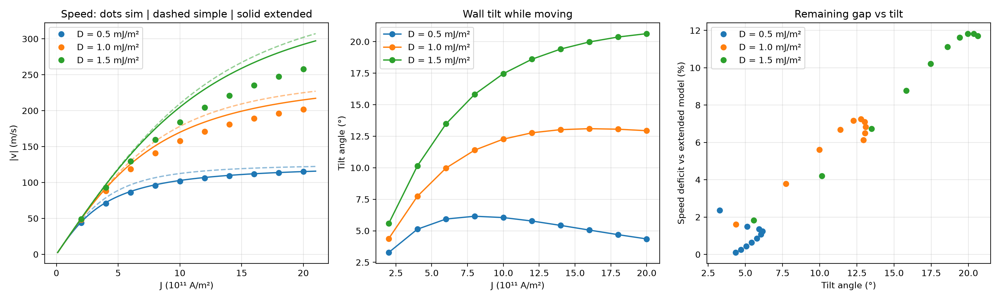
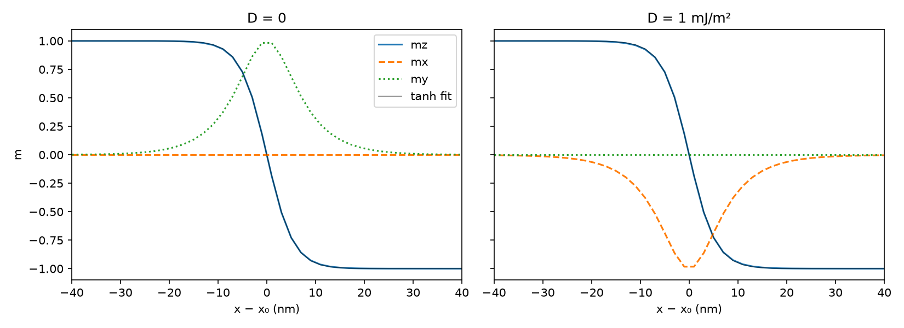

# Spin-orbit-torque-driven domain walls in Pt/Co: a micromagnetic study

**Author:** Nevan (Jairam Naga Nevan), BS-MS Physics, IISER Tirupati
**Tools:** mumax3 3.12 (GPU), Python (NumPy, SciPy, Matplotlib)
**Status:** completed October 2026

## Summary

I used mumax3 to simulate a single domain wall in a perpendicularly magnetised Pt/Co strip and drove it with spin-orbit torque (SOT) from a current in the Pt. The static wall structure and the DMI chirality energy match analytical theory to within 1.5–4%. Wall velocity grows linearly at low current density and saturates at high current, with a ceiling that rises with DMI strength. 

A simple 1D (collective-coordinate) model overestimates the velocity by up to 15%. Adding the wall's own magnetostatic Bloch preference brings agreement to within ~2% at weak DMI. The remaining deviation at strong DMI tracks the SOT-induced wall tilt (up to ~21°) across all 30 runs (Pearson r = 0.98). A 1D model cannot capture that tilt.


*Left: wall speed vs current density for three DMI strengths (dots: simulation; dashed: simple 1D model; solid: 1D model with the wall's Bloch preference). Middle: wall tilt angle during motion. Right: remaining speed deficit vs tilt angle; points from all three DMI values fall on one trend.*

## Why this system

Current-driven motion of chiral Néel walls in heavy-metal/ferromagnet stacks is the operating principle of racetrack memory, and it is closely related to SOT-MRAM switching. Three ingredients matter:

| Ingredient | Role |
|---|---|
| Perpendicular anisotropy (Pt/Co interface) | Magnetisation points up or down, so the strip stores bits |
| Interfacial DMI | Turns walls from Bloch into Néel and fixes their handedness (chirality) |
| Spin Hall effect in Pt | Charge current along the strip injects y-polarised spins into Co, producing a damping-like torque that pushes Néel walls only |

## Model and parameters

Strip: 1024 nm × 128 nm × 0.6 nm, with one up/down wall initialised at the centre. Standard Pt/Co parameters follow Thiaville *et al.* (2012).

| Quantity | Value |
|---|---|
| Saturation magnetisation M_s | 1.1 × 10⁶ A/m |
| Exchange stiffness A | 16 pJ/m |
| Uniaxial anisotropy K_u (along z) | 1.25 MJ/m³ |
| Effective anisotropy K_eff = K_u − μ₀M_s²/2 | ≈ 0.49 MJ/m³ |
| Interfacial DMI D | 0, ±0.5, 1.0, 1.5 mJ/m² |
| Gilbert damping α | 0.3 |
| Spin Hall angle θ_SH | 0.1 |
| Current density J | 2 × 10¹¹ to 2 × 10¹² A/m² |
| Cell size | 1 × 1 × 0.6 nm³ for final results (2 nm cells for exploration) |

**How SOT is implemented.** mumax3 has no built-in spin Hall module, so I used its Slonczewski spin-transfer term in the standard way for damping-like SOT: current along z, `Pol = θ_SH`, `Lambda = 1`, `EpsilonPrime = 0`, and spin polarisation `FixedLayer = (0, 1, 0)`. This gives an effective field μ₀H_SH = ħθ_SH J / (2e M_s t).

**How velocity is measured.** With a single wall between an up domain (left) and a down domain (right), the wall position is x_w = L(1 + ⟨m_z⟩)/2. For each run, the wall relaxes with the current off. The current is then switched on, the wall is given 0.5 ns to reach steady motion, and the velocity is measured over the following 0.5 ns.

**How tilt is measured.** For each row of the strip (excluding 16 nm at each edge), I find where m_z changes sign, which is where the wall crosses that row. A straight-line fit through those crossing points gives the tilt angle.

## Validation

| Test | Simulation | Expectation | Agreement |
|---|---|---|---|
| µMAG Standard Problem 4 | ⟨m⟩(t) curves | Published µMAG results | Visual match |
| Wall profile shape | m_z = −tanh(x/Δ) fits exactly | Bloch–Néel profile | ✓ |
| Wall width Δ (D = 1, 1 nm cells) | 5.49 nm | √(A/K_eff) = 5.7 nm (infinite film) | 4% |
| Convergence, 2 nm → 1 nm cells | Δ: 5.35 → 5.49 nm (+2.6%) | Converging | ✓ |
| Wall type, D = 0 | m_y = +0.98 at centre | Bloch | ✓ |
| Wall type, D = 1 mJ/m² | m_x = −0.98 at centre | Néel | ✓ |
| Chirality energy splitting | 4.76 × 10⁻¹⁹ J | 2πD·w·t = 4.83 × 10⁻¹⁹ J | 1.5% |
| Velocity convergence, 2 nm → 1 nm | Change < 1% at high J | Converged | ✓ |

The chirality test started the same Néel wall rolling both ways and compared the relaxed energies. Starting the wall with the wrong handedness leaves it stuck in a local minimum. All later runs therefore start with the preferred chirality (m_x = −1 for D > 0 in mumax3's sign convention).


*Relaxed wall profiles: Bloch wall at D = 0 (left), Néel wall at D = 1 mJ/m² (right).*

## Results

### 1. SOT moves Néel walls only, in a direction set by chirality
With J = 2 × 10¹¹ A/m² for 1 ns (2 nm cells):

| Wall | Displacement |
|---|---|
| Néel, D = +1 mJ/m² | −43.4 nm |
| Néel, D = −1 mJ/m² | +43.4 nm |
| Bloch, D = 0 | ≈ 0 (10⁻⁴ nm) |

### 2. Velocity vs current density and DMI (1 nm cells)
- **Low J:** v ∝ J, and v is almost independent of D (44–49 m/s at 2 × 10¹¹ A/m²).
- **High J:** v saturates, and the ceiling rises with D. At 2 × 10¹² A/m², v = 115, 202 and 258 m/s for D = 0.5, 1.0 and 1.5 mJ/m².

### 3. Comparison with the 1D model
In the steady-state collective-coordinate model, the wall's internal angle φ (0 = Néel, 90° = Bloch) satisfies

$$\frac{\pi}{2}\frac{H_{SH}\cos\varphi}{\alpha} = \frac{\pi}{2}H_D\sin\varphi - \frac{H_K}{2}\sin 2\varphi, \qquad v = \gamma\Delta \frac{\pi}{2} \frac{H_{SH}\cos\varphi}{\alpha},$$

where the field terms (written as μ₀H, in tesla) are

$$\mu_0 H_D = \frac{D}{M_s \Delta}, \qquad \mu_0 H_K = \frac{\mu_0 M_s  t \ln 2}{\pi \Delta} \approx 0.034\ \mathrm{T}.$$

H_K is the wall's magnetostatic preference for the Bloch configuration (Tarasenko *et al.*, 1998).

| | D = 0.5 | D = 1.0 | D = 1.5 mJ/m² |
|---|---|---|---|
| Max deviation, simple model (H_K = 0) | −10.8% | −11.7% | −14.7% |
| Max deviation, with H_K | −2.4% | −7.3% | −11.8% |
| Max tilt angle | 6.2° | 13.1° | 20.6° |

- **Weak DMI:** the missing ingredient in the simple model is H_K. Including it reduces the deviation at D = 0.5 to 0.1–2.4%.
- **Strong DMI:** the remaining deviation correlates with the measured wall tilt across all 30 runs (Pearson r = 0.98). A tilted wall is longer and is driven partly sideways, which a 1D model cannot represent. Simple wall lengthening, 1 − cos χ, accounts for roughly half of the remaining deficit.


*m_z snapshot (white = up, black = down) after 0.8 ns at J = 10¹² A/m², D = 1 mJ/m²: the wall has moved left and is visibly tilted.*

## Limitations
- Zero temperature, no disorder, no pinning, no edge roughness.
- Damping-like torque only (no field-like torque, Oersted field or Zhang–Li torque).
- α and θ_SH are typical literature values, not fitted to an experiment.
- One strip width (128 nm) and one Co thickness (0.6 nm).
- Open observation: at D = 0.5 and 1.0 mJ/m² the tilt angle peaks and then decreases at high current. I have not yet explained this.

## Possible extensions
- A collective-coordinate model that includes the tilt angle (the q–φ–χ model of Boulle *et al.*, 2013).
- Dependence on strip width and on field-like torque.
- SOT switching of a Co nanodot (a single SOT-MRAM bit) and the critical pulse duration.

## Reproducing the results
Requirements: an NVIDIA GPU (I used an RTX 4060 Laptop GPU), mumax3 3.12, Python 3 with NumPy, SciPy and Matplotlib.

```
mumax3 final_1nm.mx3
Get-ChildItem final_1nm.out\*.ovf | ForEach-Object { mumax3-convert -numpy $_.FullName }
python analyze_final.py
```

| File | Purpose |
|---|---|
| `sp4.mx3`, `plot_sp4.py` | µMAG Standard Problem 4 benchmark |
| `dw_relax.mx3`, `analyze_dw.py` | Static Bloch and Néel walls, wall-width fit |
| `dw_fine.mx3`, `width_fine.py` | Cell-size convergence test |
| `chirality.mx3` | DMI chirality energy comparison |
| `sot_move.mx3` | SOT drive: Néel (both chiralities) vs Bloch |
| `sot_sweep.mx3`, `plot_vJ.py` | Velocity vs current (2 nm, D = 1) |
| `vs_dmi.mx3`, `analyze_dmi.py`, `extended_model.py` | Velocity and tilt vs D (2 nm, exploration) |
| `final_1nm.mx3`, `analyze_final.py` | Final 1 nm sweep, models, tilt analysis |
| `final_results.csv` | All final numbers (D, J, v_sim, v_simple, v_extended, tilt) |

Simulation output folders (`*.out/`) are not tracked. Re-run the scripts to regenerate them.

## References
- A. Thiaville, S. Rohart, É. Jué, V. Cros, A. Fert, *Dynamics of Dzyaloshinskii domain walls in ultrathin magnetic films*, EPL **100**, 57002 (2012).
- S. Emori, U. Bauer, S.-M. Ahn, E. Martinez, G. S. D. Beach, *Current-driven dynamics of chiral ferromagnetic domain walls*, Nat. Mater. **12**, 611 (2013).
- K.-S. Ryu, L. Thomas, S.-H. Yang, S. Parkin, *Chiral spin torque at magnetic domain walls*, Nat. Nanotechnol. **8**, 527 (2013).
- O. Boulle *et al.*, *Domain wall tilting in the presence of the Dzyaloshinskii–Moriya interaction in out-of-plane magnetized magnetic nanotracks*, Phys. Rev. Lett. **111**, 217203 (2013).
- S. V. Tarasenko, A. Stankiewicz, V. V. Tarasenko, J. Ferré, J. Magn. Magn. Mater. **189**, 19 (1998). Source of the Néel-wall demagnetising factor used for H_K.
- A. Vansteenkiste *et al.*, *The design and verification of MuMax3*, AIP Adv. **4**, 107133 (2014).
- J. Mulkers, B. Van Waeyenberge, M. V. Milošević, *Effects of spatially engineered Dzyaloshinskii–Moriya interaction in ferromagnetic films*, Phys. Rev. B **95**, 144401 (2017).

## Acknowledgement
Simulation and analysis scripts were written with the help of an AI assistant (Claude). I ran all simulations and analyses myself and checked the results against the analytical models above.
